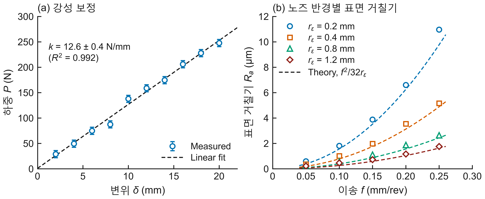
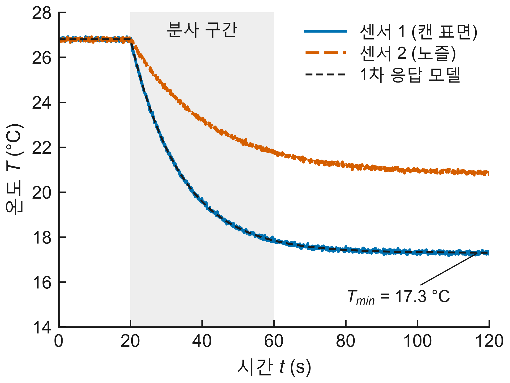
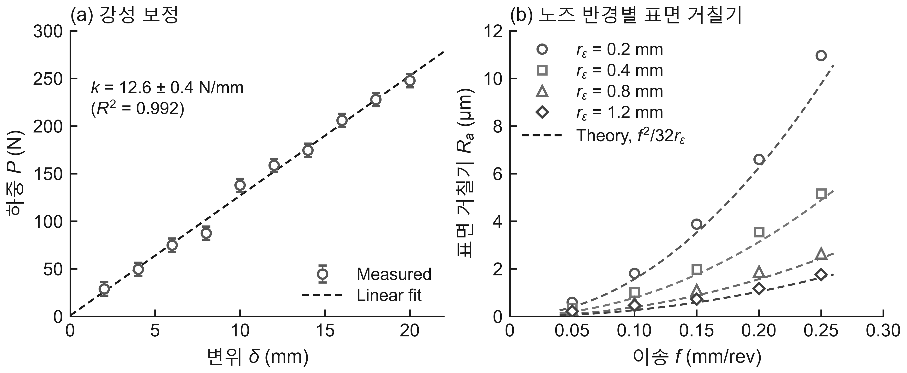

# Mechanical Engineering Laboratory Fig

기계공학실험 보고서에 넣는 그래프를 한 가지 규칙으로 그리기 위한 matplotlib 스타일 모듈 `labfig`입니다.
파일 하나(`labfig.py`)로 되어 있고, Word 보고서(본문 10 pt, Arial과 맑은 고딕)에 원래 크기로 넣는 그림을 기준으로 만들었습니다.



## 어디서 출발했나

[ChenLiu-1996/figures4papers](https://github.com/ChenLiu-1996/figures4papers)의 작업 구조에서 착안했습니다.
스타일을 한 번 적용하고, 역할별 함수로 그리고, 저장 함수로 마무리하는 3단 구조입니다.

다만 그 레포는 AI 학회 논문용이라 실험 보고서에는 그대로 쓰기 어려워서, 구조만 참고하고 코드는 처음부터 새로 썼습니다.
figures4papers의 코드, 문서, 그림은 이 레포에 들어 있지 않습니다 (figures4papers는 CC BY-NC 4.0).

| | figures4papers | labfig |
|---|---|---|
| 대상 | 학회 논문 (축소해서 삽입) | Word 실험 보고서 (원래 크기로 삽입) |
| 글꼴 크기 | 16~24 pt | 9 pt, 저장 폭이 곧 삽입 폭 |
| 주된 그래프 | grouped bar, trend, heatmap | 측정점, 측정 곡선, 이론선, 회귀 |
| 색의 의미 | 제안 기법 대 baseline | 계열 순서. 마커와 선 모양이 함께 바뀜 |
| 오차 막대와 회귀 | 정해진 규칙 없음 | `points(yerr=...)`, `linfit()` |
| 한글 | 지원 없음 | Arial과 맑은 고딕, 수식과 섞어 써도 됨 |
| 축 | 차이를 강조하려고 범위를 좁히기도 함 | 물리량 기준, 단위 필수, y축 하나 |

## 빠른 시작

필요한 것은 Python 3.10 이상, matplotlib 3.6 이상, numpy입니다. 사진 패널을 쓸 때만 Pillow가 필요합니다.
`labfig.py`를 프로젝트에 복사하거나, 이 폴더를 `sys.path`에 넣고 씁니다.

```python
import numpy as np
import labfig as lf

lf.use()                                              # 스타일 적용 (한 번만)

x = np.array([2, 4, 6, 8, 10.0])                      # 변위 (mm)
y = np.array([27.1, 51.8, 77.0, 99.5, 126.3])         # 하중 (N)

fig, ax = lf.figure("single")                         # 폭 3.6 in
lf.points(ax, x, y, yerr=2.0, label="Measured")       # 측정값: 마커와 오차 막대
fit = lf.linfit(ax, x, y, span=(0, 11), label="Linear fit")
lf.note(ax, rf"$k$ = {fit.slope:.2f} ± {fit.slope_se:.2f} N/mm", (0.5, 115))
ax.set_xlabel(r"변위 $\delta$ (mm)")
ax.set_ylabel(r"하중 $P$ (N)")
lf.legend(ax, loc="lower right")
lf.save(fig, "fig1-1.png")                            # 600 dpi PNG, 폭 3.6 in 그대로
```

전체 예시는 [examples/demo.py](examples/demo.py)에 있습니다. 예시의 숫자는 모두 만들어 낸 값입니다.



## 함수

| 함수 | 하는 일 |
|---|---|
| `use(font_size=9, latin="Arial", korean="Malgun Gothic")` | 스타일 적용 |
| `figure(width, height, nrows, ncols)` | 삽입 폭에 맞춘 그림. 폭 프리셋은 `full` 6.3, `wide` 5.0, `single` 3.6, `half` 3.1 in |
| `points(ax, x, y, yerr, xerr, label, series)` | 이산 측정값. 속이 빈 마커와 오차 막대 |
| `trace(ax, x, y, label, series)` | 촘촘하게 샘플링한 측정 곡선 |
| `model(ax, x, y, label, series)` | 이론값, 모델, 회귀선. 가는 점선 |
| `linfit(ax, x, y, through_origin, span)` | 최소제곱 직선. 기울기, 절편, R², 표준오차를 돌려줌 |
| `mark(ax, x, y, series, cross)` | 특성점 하나 (항복점, 최대점, 파단점) |
| `note(ax, text, xy, xytext)` | 주석과 지시선 |
| `region(ax, x0, x1, text)` | 구간 음영과 이름 |
| `panel(ax, "(a) ...")` | 패널 제목 |
| `plain_ticks(axis, decimals)` | 눈금 자릿수 고정, 0은 "0"으로 |
| `legend(ax)` | 측정값, 곡선, 이론선 순서로 정리한 범례 |
| `photo(ax, src, title, crop)`, `photos(images, titles)` | 사진 패널 |
| `save(fig, path, dpi=600)` | 지정한 크기 그대로 저장 |

## 규칙

1. 그림은 Word에 넣을 폭으로 처음부터 그립니다. 넣은 뒤에 줄이거나 늘리지 않으므로 모든 그림의 글자가 같은 크기(9 pt)로 인쇄됩니다.
2. 역할마다 그리는 방법이 정해져 있습니다. 이산 측정값은 마커, 촘촘한 측정 곡선은 선, 이론과 회귀는 가는 점선입니다.
3. 계열은 색과 함께 마커 모양이나 선 모양도 달라집니다. 흑백으로 인쇄해도 구분됩니다.
4. 계열 색은 정해진 순서대로 5개까지만 씁니다. 더 많으면 오류를 내므로 패널을 나눕니다.
5. 축 범위는 물리량 기준으로 정하고, 축 이름에는 단위를 적습니다. y축은 하나만 씁니다.
6. 주석 글자는 검정으로 씁니다. 색은 선과 마커만 가집니다.



## 색 검증

계열 색 `#0072B2`, `#D55E00`, `#009E73`, `#902018`, `#AA4499`는 흰 배경 기준으로 다음을 확인했습니다 (색차는 OKLab 유클리드 거리 x 100, 색각 이상은 Machado 2009 모형의 적색맹과 녹색맹).

| 검사 | 앞의 4색 (모든 쌍) | 5색 (모든 쌍) |
|---|---|---|
| 색각 이상 색차 (목표 8 이상) | 11.0 | 6.4 (보라와 파랑) |
| 일반 시야 색차 (하한 15) | 18.7 | 18.7 |
| 흰 배경 대비 (3:1 이상) | 모두 통과 | 모두 통과 |

5번째 색은 색만으로는 구분이 약하므로 마커와 선 모양 구분에 의존합니다. 색을 바꾸면 다시 검증해야 합니다.

## 한계

- 기본 글꼴은 Windows 기준입니다. 다른 환경에서는 `lf.use(latin=..., korean=...)`로 설치된 글꼴을 지정합니다.
- 한글과 수식을 한 문자열에 섞는 기능은 matplotlib 내부 구조(`matplotlib._mathtext`)에 기대고 있습니다. matplotlib 3.11에서 확인했고, 맞지 않는 버전에서는 경고만 내고 넘어갑니다.
- 막대 그래프, heatmap, 3차원 그래프용 함수는 없습니다. 스타일은 적용되므로 matplotlib 함수를 그대로 쓰면 됩니다.

## 라이선스

MIT License. [LICENSE](LICENSE)를 보세요.
